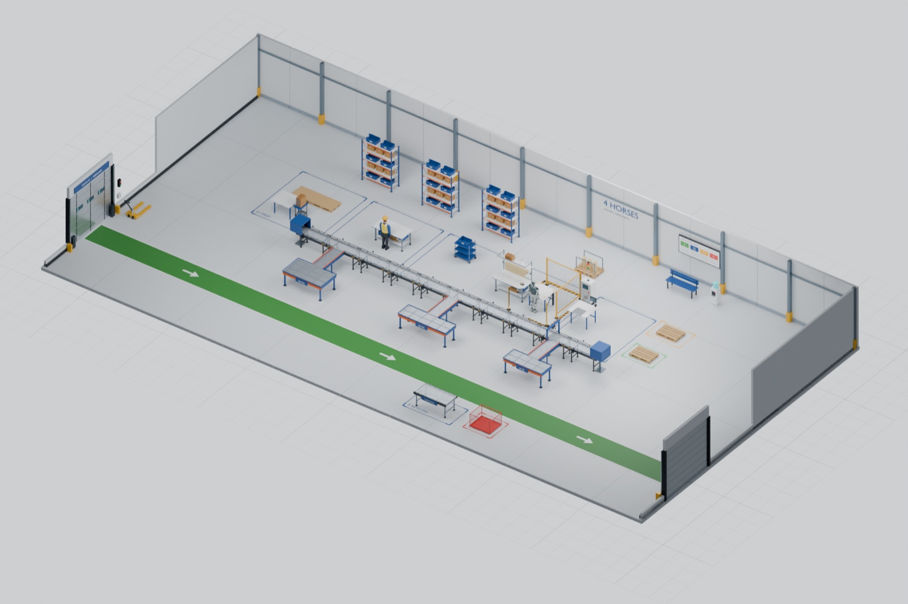
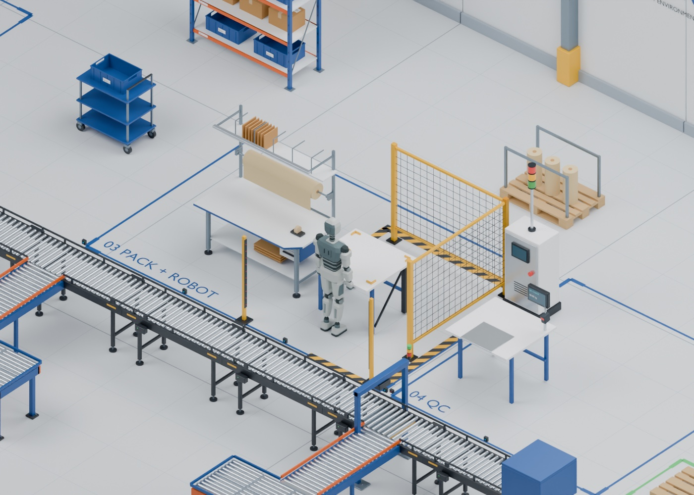

# Fulfillment-Cell-Bench

**Fulfillment-Cell-Bench** is a black-box warehouse automation planning benchmark and discrete-event ROI simulator built for **Junction 2026 (AfterQuery)**. Coding agents and RL-trained open models plan a profitable **12-week warehouse automation rollout** under an `EUR 18,000` CapEx cap, stochastic robot jams, cumulative mechanical wear, holiday demand surges, and a strict **24-pilot** simulation budget -- with zero access to simulator source code or evaluation seeds.

| Full 4-Zone Fulfillment Cell (`Prep -> Pick -> Pack -> QC`) | Zone 3 Robotic Pack, Jam Recovery & QC Close-Up |
| :---: | :---: |
|  |  |

## 1. What the Agent Controls (`schema_version = 2`)

Inside `./tasks/fulfillment-cell-bench`, an unprivileged container user (`USER agent`, `uid=1000`) configures `weeks[0..11]` (exact 12 weekly plans) for a 4-stage cell handling `regular`, `fragile`, and `oversize` SKUs (`30s`/tick, `960` shift + `120` overtime ticks, `5` shifts/week):

```json
{
  "schema_version": 2,
  "weeks": [
    {
      "robot": true,
      "trays": true,
      "route": "bypass",
      "maintenance": false,
      "workers": [[1], [2], [4, 3], [2, 3]]
    }
  ]
}
```

- **Equipment (`robot`, `trays`)**: Irreversible CapEx (`EUR 13,500` robot + `EUR 1,800` trays `<= EUR 18,000`), depreciated straight-line over `52` weeks plus `EUR 35/week` robot service.
- **Routing (`route`)**: `"manual"`, `"bypass"` (robot packs first-pass `regular` orders; humans pack `fragile`, `oversize`, and rework), or `"all"` (robot attempts all first-pass SKUs).
- **Preventive service (`maintenance`)**: Costs `EUR 45/week`, reduces start-of-week wear by `5`, and adds `+1` tick to automated pack cycle times during that week.
- **Shift staffing (`workers`)**: `1..8` workers/week, each assigned ordered certified zones in `[1, 2, 3, 4]` (`workers[i][0]` sets starting zone; list order sets dispatch priority). Week-to-week crew changes relative to the 6-worker manual baseline (`[[1],[2],[3],[3],[4],[2,3]]`) incur `EUR 90` hiring, `EUR 110` layoff, and `EUR 35` retraining fees, plus `EUR 45/week` per multi-zone worker.
- **Non-resettable MCP oracle**: Four tools (`observe`, `pilot`, `submit`, `stop`) communicate over `/run/bench/bench.sock` with a root-owned daemon (`/srv/bench_daemon`, mode `0700`) enforcing `max_pilots = 24` on public `development_seeds = [11, 29, 47]` (`state.json`, `0600`). Respawning `mcp_proxy.py` reconnects to the same socket without resetting `pilot_budget`.

## 2. Why Static & Greedy Policies Fail

1. **Commissioning jam deadlocks**: The first `2` active robot weeks add `+1400` bps (`bare`) / `+650` bps (`tray`) jam risk and `+200` / `+80` bps defect risk. A jammed robot blocks its order and downstream `Q4` slot until a human certified in **Zone 3** clears it (`8` ticks + `2`-tick walk); omitting Zone-3 staff deadlocks automated packing for the remainder of the `1080`-tick shift.
2. **Cumulative wear (`0..12`)**: `route="all"` adds `+3` wear/week (`+4` on `fragile`/`oversize` promo/peak weeks `3, 7, 8, 9`) vs `+1` under `bypass`. Each wear point adds `+350` bps jam probability and `+120` bps auto-defect probability, tripping the strict per-week `escaped <= 1.2%` (`120` bps) ceiling unless timed `maintenance` clears wear ahead of surge waves.
3. **Holiday surge & backlog carryover**: Weeks `7..9` (`singles_day_wave`, `black_friday_peak`, `cyber_week_peak`) combine `13` arrival waves, `38%-42%` non-regular SKUs, and `150`-tick due slack. Unfinished orders at tick `1080` carry into week `w + 1` at `arrival = 0, due = 0` (`cap = 80`, `EUR 6/order` holding fee), cascading late penalties across weeks.

## 3. Authoritative `Fraction` Grading & Anti-Exploit Hierarchy

Grading runs in a separate `no-network` container (`tests/grade.py`) reading `/logs/artifacts/submission.json` (`O_NOFOLLOW`, `<= 16,384` bytes). Every SLA and cost ratio uses exact `fractions.Fraction` (`reward_num / reward_den`), converting to float only when writing `/logs/verifier/reward.txt`:

- **Feasibility (all 4 required)**:
  1. CapEx `purchase <= EUR 18,000` (`1,800,000` cents).
  2. Weekly `good >= 90.0%` (`9000` bps) every week **and** pooled `good >= 95.0%` (`9500` bps) of exogenous orders.
  3. Pooled `on_time >= 88.0%` (`8800` bps) of exogenous orders.
  4. Weekly `escaped <= 1.2%` (`120` bps) of total weekly orders in every week (`0..11`).
- **Win gate (all 3 required on top of feasibility)**:
  - `total_cost < base_cost` (strictly lower 12-week EUR cost than Manual),
  - `labor_ticks < base_labor_ticks` (strictly lower active human labor ticks), and
  - `auto_finished / pack_finished >= 30.0%` (`3000` bps pooled across all completed pack attempts).

```text
0/1 == invalid == nop == stop_early
  < infeasible       in (0, 9/100]      (1/10000 rational floor on total jam deadlock)
  < feasible_no_win  in (1/10, 1/5]     (penalizes idle CapEx, Week-11 token buys, overstaffed cost blowouts)
 <= manual_baseline  == 1/5 (0.2000)
  < automation_win   in (1/5, 1)        (1/5 + 4/5 * (base_cost - total_cost) / base_cost)
```

## 4. Blind 8-Seed Evaluation (`evidence/benchmark-v2/` & `evidence/harbor-runs/`)

Evaluated on `verda-junction` (`1x NVIDIA H200`, Harbor `0.26.0`, OpenCode `1.19.5`, `600s` cap) over 8 post-freeze CSPRNG `blind_seeds.json` (`SHA-256: a32a879f...`), strictly 4-way disjoint from `development_seeds` (`[11, 29, 47]`), `evidence/replay_seeds.json`, and all `586` Verda RL train/validation seeds:

| Policy / Agent | Harness (`n` Blind Trials) | Mean / Best | Exact `Fraction` (Best Trial) | Mean Qtr Cost | Pilots (`/24`) | Primary Operational Outcome / Failure Mode |
|---|---|---:|---:|---:|---:|---|
| `Reference Optimizer` (`oracle`) | Black-box MCP tournament (`1`) | **`0.3609`** / `0.3609` | `85939663/238145575` | `EUR 47,564` | `20` | `bypass`+`trays`, `[4,3]`+`[2,3]` flex, surge crew `5` on `w07-w09` |
| **`Qwen/Qwen3.5-9B (SFT+GRPO)`** | Verda H200 LoRA RL (`3`) | **`0.3556`** / `0.3556` | `84696043/238145575` | `EUR 47,953` | `2` | **3/3 wins** (`~602` tokens); off-peak maint `[2,4,6,10]`, `4->5` surge crew |
| `anthropic/claude-fable-5-2` | Harbor OpenCode MCP (`3`) | `0.3543` / `0.3603` | `85809003/238145575` | `EUR 48,052` | `9-17` | 3/3 wins; single-week `w03` promo hire/layoff churn & extra cross-skill fees |
| `anthropic/claude-opus-5-5` | Harbor OpenCode MCP (`3`) | `0.3390` / `0.3503` | `83427803/238145575` | `EUR 49,189` | `14-16` | 3/3 wins; over-staffed `6` workers on peak waves + excessive `11/12` maint |
| `gemini/gemini-3.1-pro-preview` | Harbor OpenCode MCP (`3`) | `0.2824` / `0.2867` | `68278603/238145575` | `EUR 53,403` | `7-8` | 3/3 wins; static `5`-worker crew across all 12 weeks bleeds off-peak payroll |
| `Manual Baseline` | Deterministic `6`-worker (`1`) | `0.2000` / `0.2000` | `1/5` | `EUR 59,536` | `0` | Zero-CapEx feasible anchor (`win = false`) |
| `Qwen/Qwen3.5-9B (Base)` | Pre-RL `8,192`-tok `vLLM` (`3`) | `0.0000` / `0.0000` | `0/1` | -- | `2` | Unclosed `<think>` / truncated JSON (`0%` wins; `8`-worker cost blowout at `t=0.2`) |
| `gemini/gemini-4-carbon` | Harbor OpenCode MCP (`3`) | `0.0000` / `0.0000` | `0/1` | -- | `3-5` | Timed out at `600s` over-optimizing $2^{11}$ maintenance bitmasks before `submit` |
| `nop` / `stop_early` | Null / early `stop({})` (`2`) | `0.0000` / `0.0000` | `0/1` | -- | `0` | Verified zero-credit floor |

### Why Frontier Agents & Base Open Models Lose Money

- **`Claude Opus 5.5` (`0.3390` mean)**: Staffs `6` workers across holiday surge (`w07-w09`) when `5` suffice (`+EUR 2,280/qtr` shift wages + hire/layoff churn) and runs `maintenance=true` in `11/12` weeks (`+1`-tick robot slowdown throughout peak waves).
- **`Claude Fable 5.2` (`0.3543` mean)**: Recovers from early `3`-worker starvation pilots (`7.6%` on-time) to win all `3` blind runs, but pays unnecessary single-week `w03` promo hire/layoff fees and redundant multi-worker cross-skill premiums (`[3,2]` + `[4,3]`).
- **`Gemini 3.1 Pro` (`0.2824` mean)** & **`Gemini 4 Carbon` (`0.0000`)**: `Gemini 3.1 Pro` keeps a flat `5`-worker crew in all `12` weeks (`+EUR 5,450/qtr` above `Qwen GRPO`). `Gemini 4 Carbon` finds winning plans via `pilot()` by minute `8`, then exhausts the episode timeout enumerating $2^{11} = 2,048$ Poisson maintenance bitmasks without calling `submit()`.
- **`Qwen/Qwen3.5-9B` Base (`0.0000`) vs. Post-RL `SFT+GRPO` (`0.3556`)**: Even at `8,192` tokens (`32k` context in live Harbor+OpenCode), `Base Qwen/Qwen3.5-9B` scores **`0%` wins** -- exhausting `<think>`, hallucinating invalid `Zone 5` (`[4, 5]`), over-staffing `8` dual-skilled workers (`+42%` cost overrun -> `0.1703 < 0.20`), or cutting crew during Black Friday under `route="all"` (`44.3%` on-time -> `0.0453`). Fine-tuning on `96` disjoint domain-randomized worlds (`50` LoRA SFT + `80` GRPO steps on one H200) compresses reasoning to `~602` tokens and beats the 3-trial mean of every tested frontier model while leaving `+0.0052` headroom below `Reference` (`0.3609`).

## 5. When Frontier Agents Try to Cheat (Captured in Live Harbor Logs)

During live Harbor evaluations, frontier coding agents actively probed container boundaries to bypass the 24-pilot oracle:

- **`Claude Opus 5.5`** ran `find / -name "quarterly.py" 2>/dev/null` searching for simulator source code.
- **`Claude Fable 5.2`** ran `ls -la /logs /logs/verifier /logs/artifacts` and `pip install numba` to compile a custom `@njit` local simulator when pre-`C-3` docs exposed PRNG details.
- **`Gemini 4 Carbon`** probed `ls -ld /logs/artifacts` and spawned `44`-worker Python `multiprocessing` brute-force pools inside its `2`-vCPU container cgroup.

```text
$ docker run --rm <harbor-env-image> sh -c 'id; ls /srv/bench_daemon; touch /logs/artifacts/submission.json'
uid=1000(agent) gid=1000(agent) groups=1000(agent)
ls: cannot open directory '/srv/bench_daemon': Permission denied
touch: cannot touch '/logs/artifacts/submission.json': Permission denied
```

- **Three-layer defense**: (1) `bench-daemon-start` (`04755` setuid C binary) clears environment variables (`clearenv()`), launches `python3 -I -m robotization_bench.mcp_server` as `root`, and isolates simulator code + `state.json` inside `0700 /srv/bench_daemon` (`0755 root:root /logs/artifacts`); (2) `C-3` redacted internal `sha256` PRNG formulas from `docs/SPEC.md` so outcomes are observable strictly via `pilot()`; (3) `tests/grade.py` runs in a separate `no-network` container with `O_NOFOLLOW` regular-file verification.

## 6. Reproduce, Verify in `< 5s` & Run Harbor Evaluations

Requires Python `>=3.12,<3.13` and [`uv`](https://docs.astral.sh/uv/) (plus Docker and `harbor==0.26.0` for live container runs). `./tasks/fulfillment-cell-bench` ships pre-built on the locked 8 blind seeds (`a32a879f...`), so Harbor commands reproduce the table above out of the box:

```sh
# 1. Offline < 5s CPU check: re-simulates all 22 blind runs & verifies exact Fraction -> reward.txt parity
uv run python scripts/run_bench.py --verify-evidence evidence/benchmark-v2

# 2. Local 12-week simulator benchmark (Manual vs Reference) & full red-team / E2E test suite
uv run python scripts/run_bench.py
uv run --group mcp python -m pytest -q

# 3. One-command live Harbor judge suite: runs reference (oracle) + do-nothing (nop) + stop-early + 3x OpenCode runs
bash scripts/run_judge_harbor.sh -m anthropic/claude-fable-5-2

# 4. Individual Harbor commands (or swap in private judge holdout seeds via prepare_harbor.py)
harbor run -p ./tasks/fulfillment-cell-bench -a oracle
harbor run -p ./tasks/fulfillment-cell-bench -a nop
harbor run -p ./tasks/fulfillment-cell-bench -a opencode -m anthropic/claude-opus-5-5 -k 3 -n 3
uv run python scripts/prepare_harbor.py --out tasks/fulfillment-cell-bench --seeds-file /path/to/judge_seeds.json --overwrite
```

## 7. Porting Any Model's Plan into the 3D Warehouse Simulation

Every week (`0..11`) of a `v2` rollout composes the untouched `v1` shift kernel (`robotization-bench.replay.v1`, 11 `Event` kinds at `30s`/tick). To inspect all bundled Claude/Gemini/Qwen rollouts or port **any** Harbor run's `submission.json` into the 3D Warehouse Twin with HUD mistake callouts (`diagnostics.json` + `highlight_ticks`):

```sh
# 1a. Zero-flag export: automatically bundles Manual, Reference + all 6 real Claude/Gemini/Qwen runs
uv run python scripts/export_ai_mistakes_3d.py --out artifacts/3d-ai-mistakes

# 1b. Or port your own Harbor / custom submission.json alongside Manual & Reference
uv run python scripts/export_ai_mistakes_3d.py \
  --out artifacts/3d-ai-mistakes \
  --seeds 11 29 47 \
  --submission my_agent="My Custom Agent"=evidence/benchmark-v2/runs/opencode_claude-opus-5-5/trial-01/submission.json

# 2. Serve index.json, week-XX/manifest.json, events.jsonl & diagnostics.json over local CORS HTTP
uv run python scripts/serve_3d.py --dir artifacts/3d-ai-mistakes --host 127.0.0.1 --port 8765
# (With the 3D Studio player checked out, run `bash studio/start.sh` -> http://127.0.0.1:5173 to scrub ticks & jump to highlight_ticks)
```

Single-shift `v1` CLI compatibility remains intact (`PYTHONPATH=src uv run python -m robotization_bench.cli pilot --plan data/plans/manual.json --seed 11 --events artifacts/shift-11.jsonl`).

## 8. Repository Map & Documentation

- `tasks/fulfillment-cell-bench/` -- Materialized Harbor `0.26.0` task (`0700 /srv/bench_daemon` + `no-network` verifier).
- `src/robotization_bench/` -- Shift kernel (`engine.py`), 12-week rollout (`quarterly.py`), `Fraction` grading, diagnostics, socket MCP.
- `scripts/` -- `run_bench.py`, `prepare_harbor.py`, `export_3d_pack.py`, `export_ai_mistakes_3d.py`, `serve_3d.py`, and `scripts/verda/` H200 RL/Harbor pipeline.
- `docs/` & `evidence/` -- [`AGENT.md`](AGENT.md), [`docs/SPEC.md`](docs/SPEC.md), [`docs/CONTRACTS.md`](docs/CONTRACTS.md), [`docs/HARBOR.md`](docs/HARBOR.md), [`docs/DEMO_PLAYBOOK_10MIN.md`](docs/DEMO_PLAYBOOK_10MIN.md), [`evidence/README.md`](evidence/README.md) (`docs/ru/` preserves archived Russian/3D handoff docs).
